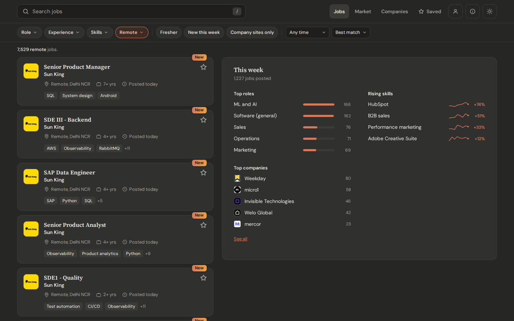
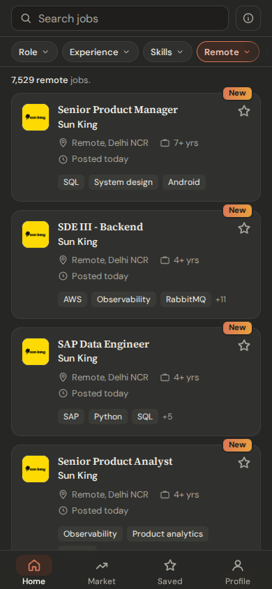

# 7xjobs

A job finder for India, live at **[jobs.imad7x.uk](https://jobs.imad7x.uk)**. Jobs come straight from companies'
own hiring systems (Greenhouse, Lever, Ashby, Workable and more), refreshed every 6 hours.

 

- Filters by role, experience, skills and remote; weekly market trends
- Installable web app with offline saved jobs

Python (Starlette) crawler and API, Postgres, Next.js + React, Docker Compose, Playwright tests.

🔒 Source is private; happy to walk through it on request.
